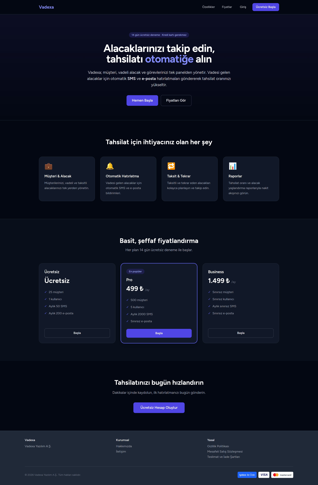
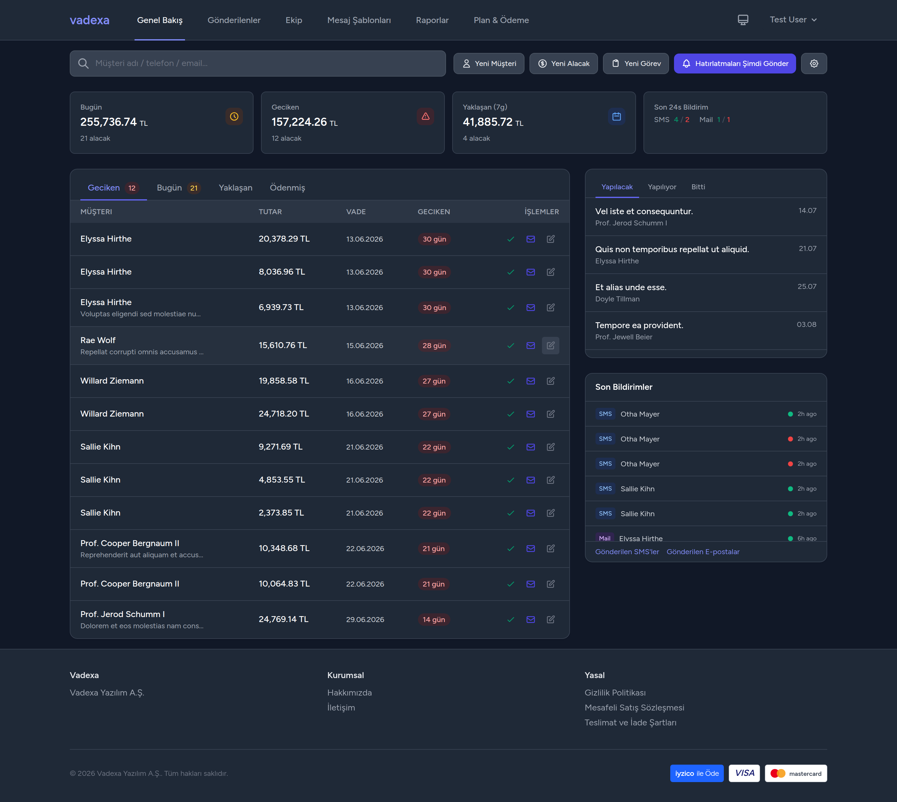
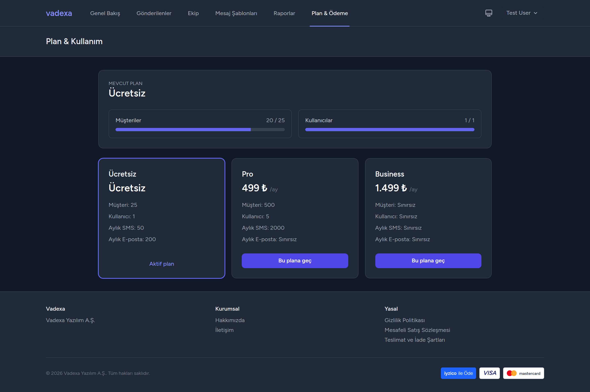
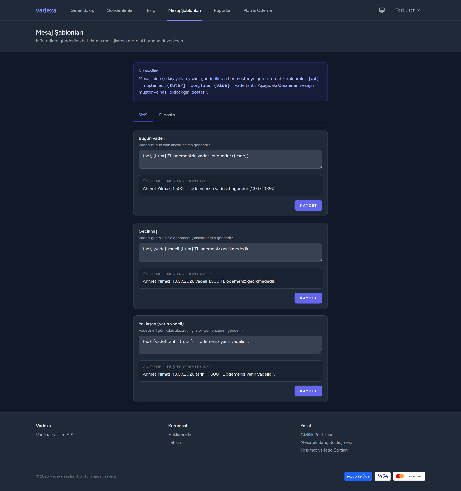
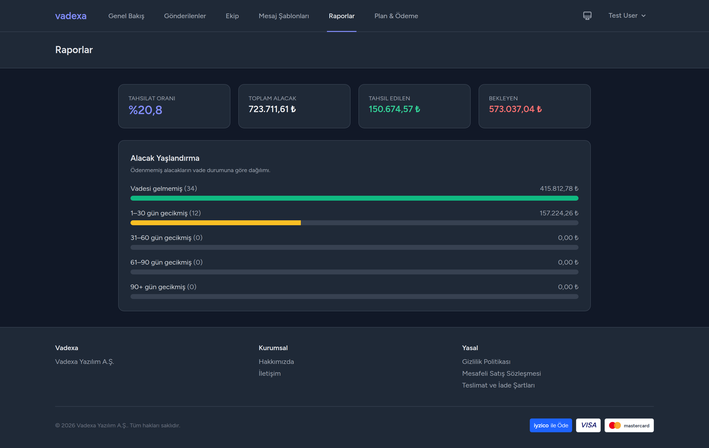

# Vadexa

**Çok kiracılı (multi-tenant) alacak takip & tahsilat hatırlatma SaaS'ı.**

Vadexa; işletmelerin müşterilerini, vadeli/taksitli alacaklarını ve görevlerini tek panelden yönetmesini, vadesi gelen alacaklar için müşterilere otomatik **SMS** ve **e‑posta** hatırlatmaları göndererek tahsilat oranını yükseltmesini sağlar. Kayıt, ekip, abonelik planları ve ödeme akışlarıyla uçtan uca bir SaaS örneğidir.

> ℹ️ **Portfolyo projesi.** SMS (NetGSM) ve ödeme (Iyzico) entegrasyonları **mock modda** çalışır — gerçek API anahtarı olmadan uçtan uca denenebilir. Gerçek anahtarlar `.env`'e girildiğinde canlıya geçer.

**Teknolojiler:** Laravel 12 · PHP 8.2+ · Blade + Alpine.js · Tailwind CSS · Vite · SQLite/MySQL · Pest/PHPUnit

---

## Öne çıkanlar

- 🏢 **Gerçek çok kiracılılık** — her firma yalnızca kendi verisini görür; tenant, giriş yapan kullanıcıdan çözülür (global scope + `TenantContext`).
- 👥 **Roller & ekip** — `owner`/`member` rolleri, e‑posta ile davet, üye çıkarma/rol değiştirme (son yönetici koruması).
- 💳 **Abonelik & ödeme** — Free/Pro/Business planları, 14 gün deneme, plan kotaları, Iyzico ödeme altyapısı (mock-ready).
- 🔔 **Otomatik hatırlatma** — vadesi gelen alacaklar için tenant saatine göre zamanlanan SMS/e‑posta bildirimleri.
- ✍️ **Mesaj şablonları** — tenant bazında düzenlenebilir SMS/e‑posta metinleri, `{ad}/{tutar}/{vade}` kısayolları ve **canlı önizleme**.
- 📊 **Raporlar** — tahsilat oranı ve alacak yaşlandırma (aging) analizi.
- 🧾 **Loglama** — gönderilen tüm SMS ve e‑postaların kaydı.
- 🌐 **Halka açık sayfalar** — landing, Hakkımızda, İletişim (künye), Gizlilik, Mesafeli Satış, Teslimat & İade.
- 🌗 **Cilalı arayüz** — açık/koyu tema, Türkçe, sekmeli/duyarlı tasarım.

## Ekran görüntüleri

**Karşılama sayfası**



**Genel Bakış (Komuta Merkezi)**



| Plan & Ödeme | Mesaj Şablonları (canlı önizleme) | Raporlar |
|---|---|---|
|  |  |  |

## Demo hesapları

`migrate --seed` sonrası hazır gelir (parola: `password`):

| E‑posta | Rol | Açıklama |
|---|---|---|
| `test@example.com` | owner | Dolu demo tenant (müşteri, alacak, log verisi) |
| `beta@example.com` | owner | İkinci tenant — veri izolasyonunu göstermek için |

## Kurulum

```bash
git clone <repo> && cd vadexa
composer install
cp .env.example .env
php artisan key:generate
touch database/database.sqlite      # SQLite (varsayılan)
php artisan migrate --seed
npm install
npm run build
```

Ardından geliştirme ortamını başlat:

```bash
composer dev
```

Bu komut `php artisan serve`, `queue:listen`, `pail` (log) ve `npm run dev`'i birlikte çalıştırır.
Uygulama: <http://localhost:8000>

> ⚠️ Blade'de yeni Tailwind sınıfı eklendiğinde `npm run dev` açık olmalı veya `npm run build` çalıştırılmalıdır.

## Mimari

Katmanlı yapı: **Controller → Service → Repository**.

```
app/
├── Http/Controllers/      # yalnızca HTTP; iş mantığını servislere devreder
├── Services/              # iş kuralları (Customer, Receivable, Notification,
│   │                      #   Tenant, Quota, Billing, Invitation, Team, Report…)
│   └── Payments/          # PaymentGateway soyutlaması + IyzicoGateway (mock/real)
├── Contracts/             # Repository ve PaymentGateway arayüzleri
├── Repositories/Eloquent/ # veri erişimi (interface arkasında)
├── Models/                # Tenant, User, Customer, Receivable, Task,
│   │                      #   Subscription, Payment, Invitation, NotificationTemplate…
│   └── Concerns/          # BelongsToTenant (global tenant scope)
├── Jobs/                  # SendSmsJob, SendDueMailJob (kuyruk)
├── Mail/                  # InvitationMail
└── Support/               # TenantContext
```

**Çok kiracılılık:** `BelongsToTenant` trait'i tüm tenant'a bağlı modellere global scope ekler; aktif tenant `ResolveTenant` middleware'i tarafından giriş yapan kullanıcıdan `TenantContext`'e yazılır. Kayıt akışı yeni bir tenant + `owner` kullanıcı oluşturur.

## Bildirimler

Vadesi gelen alacaklar için hatırlatmaları tetikle (tüm aktif tenant'lar):

```bash
php artisan notifications:send-due                    # hepsini işle
php artisan notifications:send-due --respect-schedule # yalnızca saati gelen tenant'lar
```

Zamanlayıcı bunu saatlik çalıştırır; her tenant kendi `notification_time` saatinde işlenir. Bildirimler kuyruğa alındığı için bir **queue worker** çalışıyor olmalıdır (`composer dev` bunu içerir).

## Yapılandırma (mock modlar)

```env
# SMS (NetGSM) — mock iken gerçek SMS gönderilmez, yalnızca loglanır
NETGSM_MOCK=true

# Ödeme (Iyzico) — mock iken ödemeler simüle edilir; canlı için MOCK=false + anahtarlar
IYZICO_MOCK=true
IYZICO_API_KEY=
IYZICO_SECRET_KEY=

# Firma künyesi (İletişim / yasal sayfalarda gösterilir)
COMPANY_LEGAL_NAME="Vadexa Yazılım A.Ş."
COMPANY_MERSIS=
COMPANY_ADDRESS=
```

## Test

```bash
php artisan test        # 129 test
```

Kapsam: tenant izolasyonu, plan limitleri, ekip/davet, faturalama, raporlar, bildirim şablonları, yasal sayfalar ve mevcut CRUD/bildirim akışları.

## Yol haritası

Planlanan/olası geliştirmeler için bkz. [`docs/ROADMAP.md`](docs/ROADMAP.md).

## Lisans

MIT
